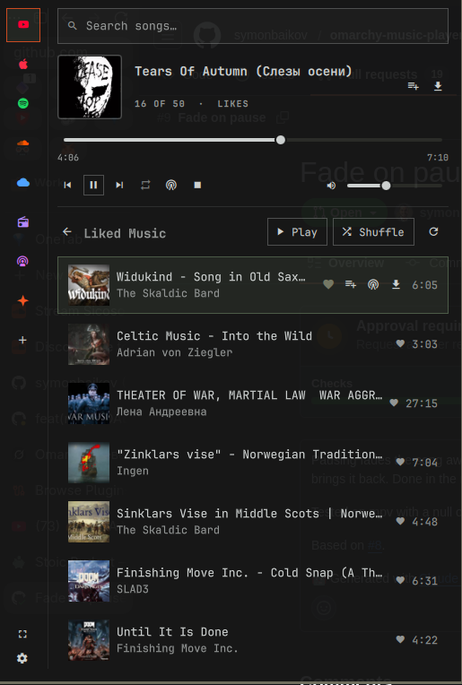

# Omarchy Music Player

**The only Apple like music player on Omarchy that you need!**



An Omarchy bar widget for your music on **YouTube Music, Spotify and
SoundCloud**, switched like tabs at the top of the panel, played through a
headless `mpv`. You don't need a browser window, browser extension or web app
open while it plays. Mix songs from all three in one queue.

(The plugin ID stays `io.github.symonbaikov.ytmusic-mpv`: marketplace IDs are
permanent. It started as a YouTube Music player.)

## Services

| Tab | What you get | Setup |
|---|---|---|
| YouTube Music | Your playlists, Liked Music, My Supermix, Explore, search, radio, likes, add to playlist | The browser you're signed in with (see Settings) |
| Spotify | Your Liked Songs and the playlists you own or collaborate on | Once: your own Spotify app (below) |
| SoundCloud | Your likes and playlists, and search across SoundCloud | Your profile name or link |
| My Music | **My Mix** (your likes from every service, alternating), your own mixed playlists, Downloads | Nothing |

**Spotify** keeps its own audio locked to Spotify's apps, so its songs play
from their **YouTube Music match** (found by ISRC, then title, artist and
duration). Reading your library needs a Spotify app of your own, because
Spotify only lets personal apps read a library, and its owner needs
**Premium** (Spotify's 2026 rules):

1. Open [developer.spotify.com/dashboard](https://developer.spotify.com/dashboard)
   and create an app with the **Web API**.
2. Add the redirect URI `http://127.0.0.1/callback` (any port is allowed on
   a loopback address).
3. Paste its **Client ID** into the Spotify tab and press **Connect Spotify**:
   you sign in to Spotify in your browser.

Only playlists you own or collaborate on can be read (Spotify doesn't give
apps the songs of other people's playlists).

**SoundCloud** is read with yt-dlp, like YouTube. Enter your profile name or
link in the SoundCloud tab. Private likes need you signed in to SoundCloud in
the browser the plugin reads cookies from.

**Mixes**: the add button next to a song (any service) adds it to one of your
mixes or starts a new one. In a mix, the stop-square button on a row removes
that song. Fades, Peak mix and Downloads work across services.

- `yt-dlp` reads your library (your playlists plus Liked Music) and each
  playlist's tracks. To see your private library it reads your browser's
  saved YouTube login cookies from disk. The browser doesn't have to be
  running.
- `mpv --no-video` plays a queue built from the playlist. With `mpv-mpris`
  installed it shows up on MPRIS, so media keys and Omarchy's OSD control it.
- The widget follows playback live over mpv's JSON IPC socket.
- **Like** songs (the heart adds them to Liked Music) and **add them to any
  of your playlists**, like in YouTube Music. The add-to-playlist list comes
  from YouTube Music's own dialog: only playlists you created (YouTube
  doesn't let anyone add to playlists they only saved), with a ✓ where the
  song already is.
- Cover art for the playing song and for every track in the list.
- Apple Music-style repeat: off, repeat the playlist, or repeat one song.
- **Fade in / fade out**: each song rises at its start and fades at its end.
- **Peak mix**: like a DJ, or Apple Music's AutoMix taken further. At a
  song's climax, it crossfades into the next song's climax: the next song
  comes in with its build-up while the first one fades, and its climax
  hits just as the crossfade ends. Each song plays from its build-up
  through its best part. The climax comes from YouTube's "most replayed"
  graph where a song has one, and from the audio's loudness: the loudest
  stretch, entered at its sharpest rise.
- **Explore**, at the top of your playlists: search YouTube Music for
  songs, and browse new albums and singles, trending songs, new music
  videos, charts, and moods & genres. A song plays with its radio after
  it, like in YouTube Music; albums, charts and moods open as playlists.
- **Download** a song (the arrow beside the heart, on a hovered row, or
  `d`): pick MP3, M4A, Opus, FLAC or WAV and a folder (the desktop's own
  folder picker). Title and artist are written into the file, and the
  cover too for MP3, M4A and FLAC. It uses the same sources as playback,
  so it works when the usual stream doesn't. **Downloads**, under Explore
  in your playlists, lists every song you saved (newest first, with its
  cover if you kept the cover) and plays them from your disk, offline.
  A file you delete or move drops out of the list.
- A **settings** screen (the gear in the panel's top right corner) for
  fades, peak mix, autoplay, playing with your account, covers and the bar
  title.
- Recommendations, the YouTube Music way. These are YouTube Music's own
  recommendations, personalized to your account when cookies are used:
  - **Start radio** from any song: a queue of similar songs. Starting it from
    the song that's playing doesn't interrupt it; the radio follows it.
  - **Autoplay**: when the queue runs out (with repeat off), it keeps going
    with songs recommended for the last one, endlessly.
  - **My Supermix** pinned at the top of your playlists.

### When YouTube acts up

Playback keeps going when it can:

- **A song's stream won't open** (YouTube changed something, a bot check):
  mpv asks the helper for a backup source before giving up on it. That is
  the song's cached audio if it has one, or else a download of the song
  through YouTube's other clients (mobile web, TV, Safari, iOS). A change
  on YouTube's side usually breaks only some of them. The panel says when
  a song came from a backup source, and which. Songs that can't play for a
  reason about the song itself (members-only, private, removed) are
  skipped at once, with the reason.
- **Backup mirrors** (off unless you turn them on, in settings): when no
  YouTube client works either, the song is fetched from independent
  YouTube front ends, [Invidious](https://invidious.io) and
  [Piped](https://github.com/TeamPiped/Piped). A mirror in another country
  can also get past a region block. Which mirrors: your own list (setting
  `mirrors`), or else the healthiest ones from the projects' public
  directories, refreshed daily. A downloaded song is only played if ffmpeg
  can decode it. You don't have to know about this setting beforehand: when
  a song won't play from YouTube at all and mirrors could help, the panel
  shows a card offering them (**Turn on backup mirrors** plays the song
  again with them; **Not now** leaves them off). If the panel is closed, a
  desktop notification says so, with a button that opens the player, and
  the bar icon shows a warning sign.
- **The connection drops mid-song**: mpv reconnects. If that fails too,
  the song is opened again where it stopped.
- **Recommendations can't be read**: radio and autoplay use the last saved
  copy, and autoplay falls back to songs from your saved Liked Music and My
  Supermix lists, so the queue doesn't run dry.
- **Lists can't be refreshed**: the saved copies stay in use.
- **Songs keep failing** (two in a row with no source working): the panel
  says so. That almost always means yt-dlp needs an update
  (`omarchy update`).

### Updates

Once a day, and right away when songs stop playing, the panel checks this
plugin's GitHub repository for a newer version (a `git fetch` of the
plugin's own checkout; nothing about you is sent). When there is one, it
shows what changed and an **Update now** button, which runs
`omarchy plugin update io.github.symonbaikov.ytmusic-mpv` and restarts the
shell; the music keeps playing. Turn it off with `updateCheck: Off`.

## Requirements

- Omarchy (Quattro shell)
- `python3`, `yt-dlp`, `mpv`
- `ffmpeg` for peak mix (Arch's `mpv` already depends on it)
- Optional: `mpv-mpris` (media keys and the OSD)
- A browser signed in to YouTube Music (Chromium, Brave, Chrome, Firefox,
  Zen, Vivaldi, Edge or Opera) to read your private library. Public playlists
  work without one. The browser doesn't have to be running.
- Chromium-based browsers encrypt their cookies with a key kept in GNOME
  Keyring or KWallet. The plugin reads which one from the browser's
  `--password-store` flag (`~/.config/chromium-flags.conf`,
  `brave-flags.conf`, …), so Omarchy's Chromium and Brave work as they come.
  The keyring has to be unlocked, which it is after a normal login.

Install the packages with Omarchy's package installer if you don't have them.

## Install

```bash
omarchy plugin add https://github.com/symonbaikov/omarchy-ytmusic-mpv --enable
```

Then set the browser you're signed in with: see [Settings](#settings).

## Remove

```bash
omarchy plugin remove io.github.symonbaikov.ytmusic-mpv
```

Removal doesn't touch the cached lists. Delete them yourself if you like:
`~/.cache/io.github.symonbaikov.ytmusic-mpv/`.

## Use

| On the bar | Does |
|---|---|
| Click | Open the panel |
| Right-click | Play / pause |
| Middle-click | Next track |
| Scroll | Volume ±5 |

In the panel: `j`/`k` move, `Enter` opens a playlist or plays a track,
`h`/`Backspace` goes back, `p` play/pause, `n` next, `b` previous,
`s` shuffle the open playlist, `Shift+R` cycle repeat, `m` start radio,
`,` settings, `e` Explore, `/` search, `d` download,
`f` like / remove like, `a` add to a playlist (all three act on the
highlighted track, or the playing one), `r` refresh, `+`/`-` volume, `Esc`
closes. Hovering a track shows like, add-to-playlist and radio buttons;
liked tracks keep a small heart.

The repeat button (next to stop) cycles like Apple Music: off (dim) →
repeat the playlist (highlighted) → repeat one song (highlighted, "1") →
off. You can set it before anything plays, and it is remembered.

IPC, for Hyprland key bindings:

```bash
omarchy-shell io.github.symonbaikov.ytmusic-mpv toggle      # open/close the panel
omarchy-shell io.github.symonbaikov.ytmusic-mpv playPause   # also: next, previous, stop
omarchy-shell io.github.symonbaikov.ytmusic-mpv cycleRepeat # off -> all -> one
omarchy-shell io.github.symonbaikov.ytmusic-mpv startRadio  # radio from the playing song
omarchy-shell io.github.symonbaikov.ytmusic-mpv toggleLike  # like the playing song
omarchy-shell io.github.symonbaikov.ytmusic-mpv addToPlaylist # pick a playlist for it
omarchy-shell io.github.symonbaikov.ytmusic-mpv openSettings  # the settings screen
omarchy-shell io.github.symonbaikov.ytmusic-mpv explore       # Explore
omarchy-shell io.github.symonbaikov.ytmusic-mpv tab sp        # a tab: yt, sp, sc or my
omarchy-shell io.github.symonbaikov.ytmusic-mpv download      # download the playing song
```

## Settings

Most of them are on the panel's settings screen (the gear). All of them
can be set with `omarchy bar set`, or on the widget's entry in
`~/.config/omarchy/shell.json` (the bar picks up changes right away):

```bash
omarchy bar set io.github.symonbaikov.ytmusic-mpv browser brave
omarchy bar set io.github.symonbaikov.ytmusic-mpv playbackCookies On
```

| Key | Default | Meaning |
|---|---|---|
| `browser` | `chromium` | yt-dlp `--cookies-from-browser` value: `chromium`, `brave`, `chrome`, `firefox`, `vivaldi`, `edge`, `opera`, a profile such as `brave:Profile 1`, or a Firefox-fork profile folder such as `firefox:~/.config/zen/<profile>`. `none` means public playlists only. |
| `playbackCookies` | `Off` | Also send cookies when playing. Turn it on only if private uploads fail to play. Turning it off, or setting `browser` to `none`, applies to a song that's already playing from the next track on. |
| `showTitle` | `On` | Show the current track title next to the icon. |
| `defaultVolume` | `60` | Starting volume (0–100). |
| `showCovers` | `On` | Show cover art. |
| `repeat` | `off` | `off`, `all` or `one`. The repeat button saves it here. |
| `autoplay` | `On` | Keep playing recommended songs when the queue runs out (repeat off). |
| `fadeIn` | `0` | Seconds each song fades in over. `0` is off. |
| `fadeOut` | `0` | Seconds each song fades out over at its end. `0` is off. |
| `transition` | `Off` | `Peak mix` switches songs climax to climax (see above). |
| `crossfade` | `6` | How long the two climaxes overlap in a peak mix, 2–16 seconds. |
| `soundcloudUser` | (empty) | Your SoundCloud name or profile link (the SoundCloud tab sets it). |
| `spotifyClientId` | (empty) | Your Spotify app's Client ID (the Spotify tab sets it). |
| `downloadDir` | `~/Music` | Where downloads go. The download screen's folder picker sets it. |
| `downloadFormat` | `mp3` | `mp3`, `m4a`, `opus`, `flac` or `wav`. The download screen sets it. |
| `downloadCover` | `On` | Embed the cover in downloads (MP3, M4A, FLAC) and show it in Downloads. |
| `updateCheck` | `On` | Check this plugin's repository for a newer version (daily, and when songs stop playing). |
| `backupMirrors` | `Off` | `On` lets backup sources use independent mirrors (Invidious, Piped) as a last resort. |
| `mirrors` | (empty) | Your own mirrors, e.g. `invidious:https://inv.example.org piped:https://pipedapi.example.org`. Empty: from the public directories. |

```json
{ "id": "io.github.symonbaikov.ytmusic-mpv", "browser": "brave" }
```

## Privacy and network use

- The cookies never leave your machine except to YouTube. yt-dlp uses them
  to request your library from `youtube.com`, and the plugin never stores or
  logs them.
- The plugin contacts YouTube only when you open the panel and a cached list
  is older than one hour, when you press refresh, or while it plays. It has
  no background polling.
- Liking a song and adding it to a playlist are the only requests that change
  your account, and they happen only when you press the heart or pick a
  playlist. They go to YouTube Music's own web API at
  `https://music.youtube.com/youtubei/v1/`, signed with your cookies exactly
  as music.youtube.com signs them (yt-dlp is read-only, so the helper makes
  these two requests itself). Nothing else is sent, and the cookies are never
  written to disk or logged.
- With `playbackCookies` on, the player passes the cookies to yt-dlp for
  each track it opens. Turning the setting off, or setting `browser` to
  `none`, takes the cookies away from the running player too: tracks it
  opens after that don't use them. If the plugin can't confirm the change,
  it stops the player.
- Radio, autoplay and My Supermix are read from YouTube Music with the same
  cookies as your library, so they're personalized like in the app. Autoplay
  makes one request when the last song in the queue starts, and only then.
- **Spotify**: the login is Spotify's Authorization Code flow with PKCE,
  answered on a one-shot server on `127.0.0.1`. The tokens are kept owner-only
  in `~/.local/share/io.github.symonbaikov.ytmusic-mpv/spotify.json` and sent
  only to `accounts.spotify.com` and `api.spotify.com`. Spotify songs are
  matched by searching YouTube Music without an account; matches are cached.
  Disconnect in settings.
- **SoundCloud** is read by yt-dlp with the same browser cookies as
  YouTube. Album art comes from Spotify's (`i.scdn.co`) and SoundCloud's
  (`sndcdn.com`) image hosts.
- **Your mixes** are kept in `~/.local/share/io.github.symonbaikov.ytmusic-mpv/mixes.json`.
- **Explore and search** ask YouTube Music's web API without an account:
  no cookies are read or sent, and the results are the same as for anyone
  in your region. Explore is cached for 6 hours.
- **Downloads** go only to the folder you picked. A song's cover is
  fetched from `https://i.ytimg.com` by its validated ID.
- **Backup sources** download a song's audio the same way, only when its
  usual stream fails to open, into the same cache.
- **Backup mirrors**, only when turned on, and only for a song nothing else
  could play: the mirror (a server run by someone else) is asked for that
  song's ID and sends its audio. Mirrors never get cookies or your login.
  To find mirrors, the plugin reads `api.invidious.io` and
  `piped-instances.kavin.rocks` once a day, unless you list your own.
- **Peak mix** downloads the audio of the playing song and the next one
  (with yt-dlp, from YouTube, with the same cookies as playback, so none
  unless `playbackCookies` is on) to
  `~/.cache/io.github.symonbaikov.ytmusic-mpv/mix/`, and renders the
  transition there with `ffmpeg`. It keeps the 12 newest downloads and the 4
  newest rendered songs and deletes older ones. Nothing is downloaded while
  peak mix is off.
- Cover art is YouTube's own track thumbnail from `https://i.ytimg.com`. The
  URL is built only from a validated video ID. It is fetched for the playing
  song and for the list rows on screen, and never with your cookies. Turn it
  off with `showCovers: Off`.
- Lists are cached in `~/.cache/io.github.symonbaikov.ytmusic-mpv/`. The mpv
  socket and the current queue live in
  `$XDG_RUNTIME_DIR/io.github.symonbaikov.ytmusic-mpv/`.
- All titles from YouTube are shown as plain text. IDs, sizes and lengths are
  validated before use.

## Troubleshooting

- **"Couldn't load"** or **"Not signed in"**: you aren't signed in to YouTube
  Music in the configured browser, or `browser` points at the wrong profile.
  For a Chromium-based browser without a flags file, name the keyring
  yourself, for example `chrome+gnomekeyring` or `chromium+kwallet6`. For a
  Flatpak browser, give its profile folder, for example
  `chromium:~/.var/app/org.chromium.Chromium/config/chromium/Default`. Test
  it from a terminal:
  ```bash
  ~/.config/omarchy/plugins/io.github.symonbaikov.ytmusic-mpv/bin/ytmusic-mpv \
    playlists --browser chromium --max-age 0
  ```
- **Sign-in problems** show a **Sign in** button. It opens YouTube's sign-in
  page in the browser the cookies are read from (Zen, LibreWolf and so on are
  recognized by their profile folder).
- **Like or add-to-playlist failed**: the panel shows YouTube's own reason.
  `~/.cache/io.github.symonbaikov.ytmusic-mpv/api.log` has the endpoint, HTTP
  code and YouTube's status for each failure, and never headers or cookies.
- **A song is skipped**: the panel says which one and YouTube's reason. If
  it's one your account can play (members-only, sign-in or age check), the
  notice has a **Play with my account** button: it turns `playbackCookies`
  on and plays the song again.
- **Peak mix doesn't switch**: a song needs at least a minute or so to have
  a climax to leave from, and the next song is prepared as the current one
  starts, so the first transition comes once the playing song reaches its
  climax. `mpv.log` has a "peak mix" line for each song, saying why when
  one is skipped.
- **Which mirrors work from here**: run
  ```bash
  ~/.config/omarchy/plugins/io.github.symonbaikov.ytmusic-mpv/bin/ytmusic-mpv mirrors --check
  ```
  It asks each mirror about one public test video and prints which answer.
  Public mirrors come and go; if none answer, list a working one yourself.
- **A track won't play**: check `~/.cache/io.github.symonbaikov.ytmusic-mpv/mpv.log`,
  and keep `yt-dlp` up to date (`omarchy update`).

## Development

```bash
node --test tests/*.test.mjs
python3 -I -m unittest discover -s tests -p 'test_*.py'
omarchy plugin validate .
```

`bin/ytmusic-mpv` is also a small CLI: `playlists`, `tracks <id>`,
`play <id> [--index N] [--shuffle 1]`,
`radio <video-id> [--mode replace|keep|append]`, `like <video-id> [--remove 1]`,
`add <playlist-id> <video-id>`, `liked`, `stop` and `mixprep` (called by
`mpv/ytmusic.lua`, the script the player runs for fades and peak mix).
Each prints JSON lines.

## Maintenance

The repository looks after itself, with a human approving every change:

- **Watchdog** (`.github/workflows/watchdog.yml`, every 3 hours):
  `tools/watchdog.py` plays public songs through the plugin's own helper
  with the latest yt-dlp: a radio list, real playback in mpv, each YouTube
  client, the backup download, a peak mix and the mirrors. When playback is
  broken it opens a `watchdog` issue (and closes it once playback works
  again). When YouTube only refuses the CI runner itself (a bot check on a
  data-center IP), the run is *inconclusive* and raises no alarm.
- **Fix**: for a new breakage, Claude (claude-code-action) reproduces it,
  finds the cause and opens a pull request with the fix, its tests and a
  version bump, labelled `auto-fix`. If only a newer yt-dlp helps, it says
  so on the issue instead. It never pushes to `main`: the branch ruleset
  requires a pull request, which the owner reviews and merges.
- **Release** (`.github/workflows/release.yml`): a new version on `main` is
  tagged and released, and the marketplace is asked to verify that exact
  commit (its maintainer approves it). Users get the update from the panel.

Secrets: `CLAUDE_CODE_OAUTH_TOKEN` (from `claude setup-token`) for fixes,
`MARKETPLACE_TOKEN` (a classic GitHub token with `public_repo`) for the
marketplace requests. Without them, the watchdog still opens issues and
releases still happen.

Run the watchdog locally: `python3 tools/watchdog.py`. It uses throwaway
directories and a silent mpv, so it doesn't touch a running player.

## License

[MIT](LICENSE) © 2026 Symon Baikov
