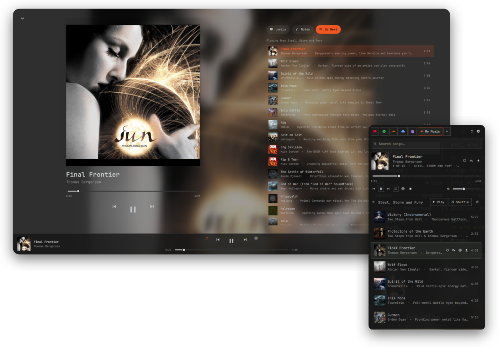

<div align="center">
  <h1>Omarchy Music Player</h1>
  

  <p><strong>The only Apple Music experience on Omarchy you ever need!</strong></p>

  <p>
    &nbsp;&nbsp;
    &nbsp;&nbsp;
    &nbsp;&nbsp;
    &nbsp;&nbsp;
    &nbsp;&nbsp;
    
  </p>

  
</div>

All your music in one player that lives in your Omarchy bar: **YouTube
Music, Spotify, SoundCloud, your own files and music server, and internet
radio**, played by a headless `mpv`. No browser, no web app, no
subscription of its own.

## What makes it special

- **🎧 Every service, one queue.** Tabs for YouTube Music, Spotify, SoundCloud,
  your files, radio and your mixes. Mix songs from all of them in one
  playlist; **My Mix** alternates your likes from every service.
- **✨ AI Mix.** The AI that already runs on your Omarchy (Claude, Codex or
  OpenCode) learns your taste from what you finish, skip and like, and picks
  a playlist for you every day, each song with a line on why. Ask for a
  mood: "epic for work", "calmer".
- **🖥 A real Apple Music window.** Big covers and shelves, a blurred cover
  behind Now Playing, Up Next. It tiles, moves and goes full screen like any
  Omarchy window (`Shift+F`).
- **🎤 Lyrics in time** with the song, Apple Music style: the line being sung
  lights up and the rest drifts by. Click a line to jump there.
- **🎸 Notes for learning a song.** Its chords in time with it, heard from the
  audio itself, with fingerings on a guitar and a keyboard; plus Songsterr
  tabs, MuseScore sheet music and Ultimate Guitar.
- **🌊 Peak mix.** Like a DJ: at a song's climax it crossfades straight into
  the next song's climax. Fades in, out and on pause, too.
- **📁 Your own music.** `~/Music` in one click; Navidrome, Jellyfin and Plex;
  S3, Google Drive, Dropbox, OneDrive, SFTP, SMB, WebDAV. Folders become
  albums with their covers.
- **📻 50,000 radio stations** by country and genre, with the song on air.
- **🛡 It keeps playing.** When YouTube changes something, songs come from
  backup sources; dropped streams reopen; one click files a filled-in bug
  report; a watchdog finds breakages and proposes fixes before you notice.
- **⬇️ Downloads** in MP3, M4A, Opus, FLAC or WAV, with covers, playable offline.

## Install

```bash
omarchy plugin add https://github.com/symonbaikov/omarchy-music-player --enable
```

You need `python3`, `yt-dlp`, `mpv` and `ffmpeg` (Omarchy has them).
Optional: `mpv-mpris` (media keys), `rclone` (cloud storage), `python-numpy`
(chords). For your private YouTube Music library, sign in to it in your
browser; the player reads that login, and the browser doesn't have to run.

Then click the music note in your bar. Spotify, SoundCloud, your files and a
server connect from their tabs, in a click or two.

## Use

| | |
|---|---|
| Click the bar icon | The panel |
| Right-click / middle-click / scroll | Play-pause / next / volume |
| `Shift+F` or the icon beside ⚙ | The player window |
| `/` | Search |
| `l` / `c` in the window | Lyrics / Notes |

Everything else, the shortcuts and the commands for your own key bindings:
[docs/usage.md](docs/usage.md).

## Documentation

| | |
|---|---|
| [Services](docs/services.md) | YouTube Music, Spotify, SoundCloud, Files and servers, Radio, My Music |
| [The player window](docs/player-window.md) | The window, Lyrics, Notes |
| [AI Mix](docs/ai-mix.md) | How it learns your taste, and what it sends |
| [Playback](docs/playback.md) | Peak mix, fades, radio and autoplay, downloads, backup sources, updates |
| [Usage](docs/usage.md) | The bar, keys, IPC |
| [Settings](docs/settings.md) | Every setting |
| [Privacy](docs/privacy.md) | What goes where, and what stays on your machine |
| [Troubleshooting](docs/troubleshooting.md) | When something doesn't work |
| [Architecture](docs/architecture.md) | How it's built, for contributors |
| [Maintenance](docs/maintenance.md) | Watchdog, automatic fixes, releases |

The plugin ID stays `io.github.symonbaikov.ytmusic-mpv`: marketplace IDs are
permanent, and it started as a YouTube Music player.

## License

[MIT](LICENSE) © 2026 Symon Baikov
