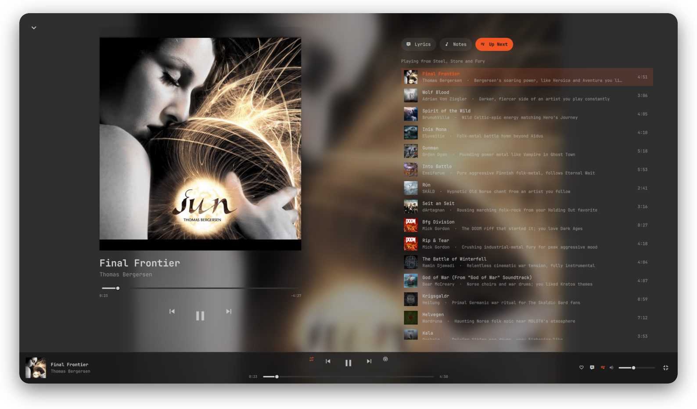

# The player window

The full-screen icon at the foot of the panel's left rail (above the gear), or `Shift+F`, opens the whole player
in its own window, like Apple Music's app. Hyprland treats it like any other
window: it tiles, moves (drag its title, or `Super`+drag; `Super+T` floats
it), goes to another workspace and closes with `Super+W`. Its button, `F11`
or a double click on its title makes it full screen. Opening it again while
it's open brings it to you.

- **Sidebar**: search, Listen Now, Explore, Now Playing, every service,
  Downloads, your mixes.
- **Listen Now**: the song that's playing, big; Made for you (AI Mix),
  Recently played, your mixes, every service's lists, and Explore's shelves.
- **A playlist**: its artwork, Play and Shuffle, then its songs with covers.
- **Now Playing**: the cover big, blurred behind everything, and beside it
  Lyrics, Notes or Up Next.
- **The player** along the bottom: repeat, transport, radio, progress, like,
  lyrics, queue, volume, full screen.

Keys: `Esc` goes back, `Space` plays and pauses, `/` searches, `n` / `b`
next and previous, `f` likes, `+` / `-` volume, `l` Lyrics, `c` Notes,
`F11` or `Shift+F` full screen.

Panel screens asked for from the window (settings, a download, adding to a
playlist, connecting Spotify or SoundCloud) open in the panel, over it.

## Lyrics

Like Apple Music's: big lines that light up in time with the song and scroll
by themselves; the others dimmed and soft. Click a line to jump there;
scroll yourself and it waits a few seconds before following again.

Timed lyrics come from [LRCLIB](https://lrclib.net), looked up by the song's
artist, title and length (YouTube titles are cleaned of "Official Video" and
the like first). When it has none, YouTube Music's own lyrics are shown as
text, marked as not timed (many songs have no timed lyrics anywhere yet):
they glide down roughly with the song's progress instead of following it
line by line. Lyrics are fetched only while the view is open,
and cached.

## Notes

For learning a song:

- **Its chords, in time with it**, heard from the song's own audio, so every
  song has them. The chord playing now is big, with its fingering on a
  guitar and its notes lit on a keyboard; the chords to come follow (click
  one to go there), with the song's key. Flats where musicians write them
  (Gm is G · B♭ · D). Like any chord detection it's approximate: a good
  start, not a transcription. Needs `python-numpy` (the view offers to
  install it).
- **Sheet music and tabs**: [Songsterr](https://www.songsterr.com)'s tabs and
  notation for the song, per instrument (guitar, bass, drums, keys …),
  opened in their own window; and a search on MuseScore (sheet music) and
  Ultimate Guitar (chords).
